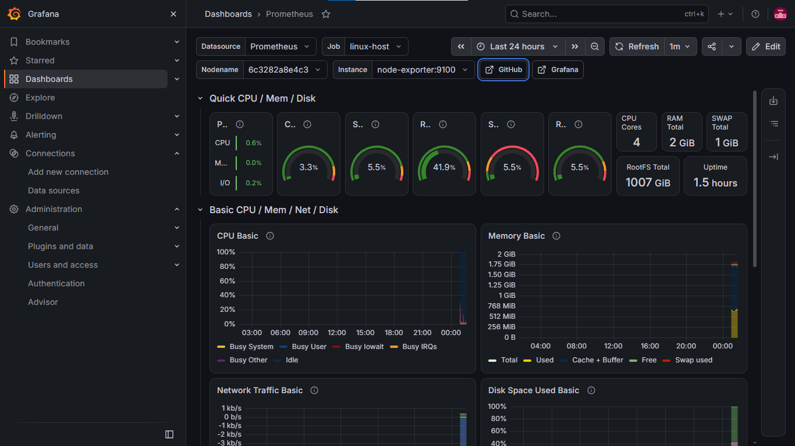

# 📊 Observability Stack: Prometheus, Grafana & Node Exporter

Laboratório prático de **Observabilidade e Monitoramento** utilizando **Docker** e **Docker Compose** para provisionar uma stack completa de coleta e visualização de métricas de infraestrutura Linux.



---

### 🎯 Objetivo do Projeto

Demonstrar na prática como automatizar o deploy de ferramentas de monitoramento seguindo conceitos de **Infraestrutura como Código (IaC)** e **Provisionamento Automatizado**, eliminando configurações manuais repetitivas.

---

### 🏗️ Arquitetura da Solução

A stack é executada em uma rede Docker dedicada (`monitoring-net`) composta por três containers:

1. **Node Exporter (`:9100`):** Agente responsável por expor métricas de hardware e sistema operacional do host Linux (CPU, memória RAM, disco, I/O e tráfego de rede).
2. **Prometheus (`:9090`):** Banco de dados de séries temporais (TSDB) que realiza o *scrape* (coleta) das métricas do Node Exporter a cada 15 segundos.
3. **Grafana (`:3000`):** Plataforma de visualização que já inicia conectada automaticamente ao Prometheus via arquivo de provisionamento (`datasource.yml`).

---

### 🛠️ Tecnologias Utilizadas

* **Containers:** Docker & Docker Compose
* **Monitoramento:** Prometheus & Node Exporter
* **Visualização:** Grafana
* **Sistema Operacional:** Linux

---

### 🚀 Como Executar o Laboratório

1. **Clone o repositório:**
   ```bash
   git clone https://github.com
   cd observability-stack-docker
   ```

2. **Suba os containers em segundo plano:**
   ```bash
   docker compose up -d
   ```

3. **Verifique se os serviços estão ativos:**
   ```bash
   docker compose ps
   ```

4. **Acesse as interfaces web:**
   * **Grafana:** `http://localhost:3000` *(Usuário: `admin` | Senha: `admin`)*
   * **Prometheus:** `http://localhost:9090` *(Verifique em `Status > Targets` se o job `linux-host` está com estado `UP`)*
   * **Node Exporter:** `http://localhost:9100/metrics`

5. **Encerrar o ambiente (limpeza):**
   ```bash
   docker compose down -v
   ```
